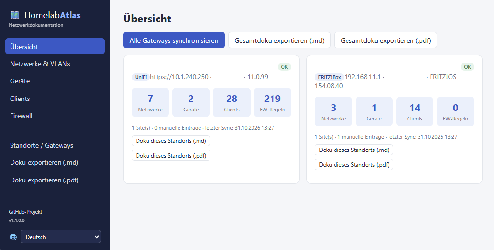

# HomelabAtlas

Easy light Network documentation for your homelab – automatically from UniFi and FRITZ!Box, plus manual entries for everything else.
ASP.NET Core (.NET 10) + Blazor Server, SQLite, runs as a Linux Docker container. Multilingual (English, German, extensible).



## 1. What HomelabAtlas is for

**HomelabAtlas is a central documentation and inventory tool for homelabs and home networks.** It automatically collects network information from UniFi and FRITZ!Box devices, then lets you add information that cannot be discovered automatically—such as third-party devices, notes, and manually maintained locations.

Its main purpose is to make it easier to answer questions like: **Which networks, VLANs, devices, clients, and firewall rules do I have, and which gateway or location are they associated with?**

## 2 What It Documents

### 2.1 Networks and VLANs

HomelabAtlas can document networks with details such as VLAN IDs, subnets, gateway addresses, and DHCP settings. This makes it easier to keep track of networks intended for servers, IoT devices, guests, or everyday use.

### 2.2 Devices and Clients

The application distinguishes between infrastructure devices and connected clients:

- **Devices**, such as gateways, switches, access points, and mesh nodes, where the data source provides that information
- **Clients**, such as computers, phones, and other network-connected devices, including available IP and MAC addresses and online status
- Additional details such as manufacturer, model, firmware version, or physical location when available

You can add your own details and notes—for example, a device’s rack position or purpose.

### 2.3 Firewall Zones and Rules

For UniFi, HomelabAtlas can document firewall zones and policies. Depending on the information provided by the API, this can include actions, source and destination zones, filters, protocols, enabled status, and rule order.

FRITZ!Box does not provide equivalent rule-based firewall policies. Instead, HomelabAtlas documents IPv4 port forwarding entries as rules of the form **“Internet → LAN.”** This records existing port forwards; it does not manage firewall settings.

## 3 Data Sources

### 3.1 UniFi

HomelabAtlas connects to UniFi Cloud Gateways through the local UniFi Network Integration API. It can manage multiple gateways and collect information such as sites, networks, devices, clients, firewall zones, and firewall policies.

You can start synchronization for an individual gateway or for all configured gateways. Automatic synchronization can also run on a schedule. The application displays the synchronization status and any warnings or errors.

### 3.2 FRITZ!Box

FRITZ!Boxes are queried using TR-064. Depending on the services available, HomelabAtlas can collect information such as the model and FRITZ!OS version, LAN and DHCP settings, external WAN IP address, connected hosts, mesh nodes, and port forwards.

The FRITZ!Box must be reachable from the container’s network. TR-064 is normally available only on the local network, and the FRITZ!Box must be configured with a user account that has the required permissions.

### 3.3  Manual Entries

Not everything can be discovered through a gateway API. You can manually add networks, devices, clients, firewall zones, and rules. This is useful for documenting:

- A switch or server behind a gateway
- NAS devices, printers, PLCs, or other third-party equipment
- Information not provided by UniFi or FRITZ!Box
- Locations without a supported API connection

Manual entries can be associated with a synchronized site or with a **manual location**. Synchronization does not modify or delete manual entries. Notes attached to synchronized entries are also preserved across later synchronizations.

## 4 Dashboard

The overview page shows statistics for each configured gateway or location, such as the number of networks, devices, clients, and firewall rules. It also displays synchronization status and the time of the last sync.

Tables support features including:

- Per-column filters, including text and selection filters
- Search and filtering by location
- Sorting, with IP addresses and VLAN IDs sorted numerically
- Detail views with notes and raw data

This makes it easier to find information by location, device type, or network object.

### 4.1 Documentation Exports

HomelabAtlas can export documentation as **Markdown** or **PDF**, either for the entire environment or for a single gateway. Exports can include networks, devices, firewall zones and rules, clients, and notes. Markdown can be copied into a wiki, knowledge base, or technical documentation system.

### 4.2 Common Use Cases

- Maintain an up-to-date inventory of your home network without entering every basic detail manually.
- Look up VLANs, subnets, and DHCP ranges in one place.
- Identify which devices and clients belong to a particular location.
- Document firewall rules and FRITZ!Box port forwards.
- Combine automatically collected gateway data with notes and third-party devices.
- Share or archive portable network documentation as Markdown or PDF.

### 4.3 Tables
- **Column filters** below each header: text box (contains) or drop-down (exact value, incl. "(empty)")
  - `=value` → exact match · `!value` → does not contain
- **Sorting** by clicking a header (ascending / descending / off); IP addresses and VLANs sort numerically
- Location filter and full-text search on top; click a row → notes & raw data

### 4.3 What HomelabAtlas Is Not

HomelabAtlas is primarily a **documentation tool**, not a network monitoring or configuration management system. It is not designed to change UniFi or FRITZ!Box settings, actively manage devices, trigger availability alerts, or analyze network traffic. The information shown depends on what each data source makes available.

### 4.4 Hosting and Security Notes

The application runs as an ASP.NET Core/Blazor Server app in a Linux Docker container and stores its data in SQLite. A persistent volume for `/data` is important so the database, data protection keys, and optional language files survive container updates. Backups should include `/data/keys`; without those keys, stored API keys and passwords may no longer be decryptable.

**Important:** HomelabAtlas has no built-in authentication and may contain sensitive network and firewall information. Run it only on an internal network or behind an authenticated reverse proxy. Do not expose it publicly without protection.

**In short:** HomelabAtlas is for anyone who wants a clear, searchable, and exportable record of their homelab—with automatic data collection from UniFi and FRITZ!Box, plus manual entries for everything else.

## 5 Getting started

You need Docker Engine (or Docker Desktop) running. The app listens on port `8080` and stores its database,
data protection keys and optional custom locales in `/data`. Use a persistent volume to keep this data across
container updates.

### 5.1 With Docker Compose

```bash
mkdir homelabatlas
cd homelabatlas
curl -L https://github.com/Michi1983/HomelabAtlas/blob/main/docker-compose.yml?raw=true -o docker-compose.yml
docker compose up -d
```

Open <http://localhost:8080> (or `http://<docker-host>:8080` when Docker runs on another host). The Compose
configuration creates and uses the named `homelabatlas-data` volume. Stop the app with `docker compose down`;
the volume and its data are retained. Run `docker compose up -d` to start it again.

### 5.2 With Docker

Build the image from the repository root, then create and start the container with a named data volume:

```bash
docker volume create homelabatlas-data
docker run -d --name homelabatlas --restart unless-stopped \
  -p 8080:8080 \
  -v homelabatlas-data:/data \
  -e TZ=Europe/Berlin \
  ghcr.io/michi1983/homelabatlas:latest
```

Open <http://localhost:8080>. Stop and restart the container with `docker stop homelabatlas` and
`docker start homelabatlas`. The named volume keeps application data when the container is removed or replaced.

### 5.3 Configuration
| Variable | Default | Description |
|---|---|---|
| `Sync__IntervalMinutes` | 60 | Automatic sync interval, `0` = off |
| `Localization__DefaultCulture` | `en` | Fallback language if the browser language is not available |
| `DataDir` | `/data` | SQLite DB, data protection keys, custom locales (volume!) |
| `ASPNETCORE_HTTP_PORTS` | 8080 | Internal port |
| `Gateways__N__Kind` | `Unifi` | Optional pre-configuration: `Unifi` or `FritzBox` |
| `Gateways__N__Name` / `__Host` / `__Location` | | Name, host, location |
| `Gateways__N__ApiKey` | | UniFi API key |
| `Gateways__N__Username` / `__Password` | | FRITZ!Box credentials |

**Backup:** back up the `/data` volume (`homelabatlas.db` + `keys/`). Without `keys/`, stored API keys/passwords cannot be decrypted.

### 5.4 Languages
English is the primary language; German is included.

**How the language is chosen** (first match wins):
1. Query string `?culture=de` (also works for the export: `/export/markdown?culture=de`)
2. Language selector in the sidebar (stored in a cookie for one year)
3. Browser language (`Accept-Language`)
4. `Localization__DefaultCulture`


## 6 Data sources

### 6.1 UniFi (automatic)
Any number of UniFi Cloud Gateways (e.g. UCG Fiber) via the official local Network Integration API
(`https://<UCG>/proxy/network/integration/`, header `X-API-KEY`):

| Area | Endpoint |
|---|---|
| Sites | `GET /v1/sites` |
| Networks / VLANs | `GET /v1/sites/{id}/networks` + detail |
| Devices | `GET /v1/sites/{id}/devices` |
| Clients | `GET /v1/sites/{id}/clients` |
| Firewall zones | `GET /v1/sites/{id}/firewall/zones` |
| Firewall policies | `GET /v1/sites/{id}/firewall/policies` |

Create an API key on each UCG: UniFi Network → *Settings → Integrations*.

### 6.2 FRITZ!Box (automatic, TR-064)
Any number of FRITZ!Boxes via TR-064 (SOAP, digest authentication, `http://<box>:49000` or `https://<box>:49443`):

| Area | TR-064 service / action | Result in HomelabAtlas |
|---|---|---|
| Model, FRITZ!OS | `DeviceInfo:GetInfo` | Device "router" + version |
| LAN | `LANHostConfigManagement:GetInfo` | Network "LAN" (subnet, gateway, DHCP range) |
| WAN | `WANIPConnection` / `WANPPPConnection:GetExternalIPAddress` | Network "WAN / Internet" (external IP) |
| Host list | `Hosts:X_AVM-DE_GetHostListPath` | Clients incl. online state, wired/Wi-Fi/guest/VPN |
| Mesh | `Hosts:X_AVM-DE_GetMeshListPath` | Devices: repeaters / mesh nodes |
| Port forwardings | `WAN*Connection:GetGenericPortMappingEntry` | Firewall rules "Internet → LAN" (action `FORWARD`) |

The FRITZ!Box has no rule-based firewall like UniFi, so IPv4 port forwardings are documented as firewall rules.

**Prerequisites on the FRITZ!Box**
1. *Home Network → Network → Network Settings*: enable **"Allow access for applications"**
   (depending on FRITZ!OS also "Transmit status information over UPnP").
2. *System → FRITZ!Box Users*: create a dedicated user (e.g. `homelabatlas`) with the right **"FRITZ!Box settings"**.
3. In HomelabAtlas: *Locations / gateways → FRITZ!Box*, host `fritz.box` or the IP, user name + password → *Test* → *Sync*.

TR-064 is only reachable from the local network – the container must be able to reach the box on port 49000/49443.

### 6.3 Manual
Your own networks, devices (switches, servers, NAS, printers, PLCs …), clients, firewall zones and rules:
- assign them to a synced site (e.g. a third-party switch behind the UCG or FRITZ!Box) **or**
- to a **manual location** without API (*Locations / gateways → Manual location*).
- Manual entries are marked purple, can be edited/deleted (✎ / 🗑) and are **never** modified or deleted by the sync.

## 7 Extending HomelabAtlas

### 7.1 Adding a language
**Adding a language** – no rebuild required: copy `src/HomelabAtlas/Locales/en.json` to `<culture>.json`
(e.g. `fr.json`), translate the values (keep keys and `{0}` placeholders), set `"_language"` to the native name,
and either add it to `Locales/` or place it in the data volume under `/data/locales/` and restart.
Files in `/data/locales/` can also override single texts of the built-in languages.

### 7.2 Adding another gateway type
Implement `IGatewayProvider` (`Integrations/`) – return a `GatewaySnapshot` with sites, networks, devices, clients,
zones and rules – and register it in `Program.cs`. Sync, reconciliation (incl. protection of manual entries and notes),
UI and export work automatically; only a new `GatewayKind` value and the form fields need to be added.

### 7.3 Database
The schema is created on first start via `EnsureCreated`. For later model changes, switch to EF Core migrations
(or delete the volume for a fresh install).


## 8 Notes
- No built-in authentication – run it internally only or behind a reverse proxy with authentication (it contains firewall rules!).
- Missing endpoints/services show up as a warning; everything else is still synced.
- Sync warnings/errors are logged in English regardless of the UI language.


